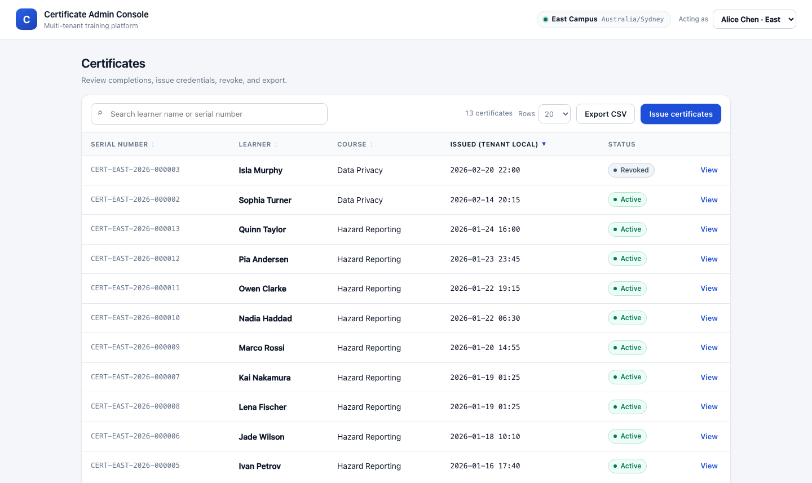
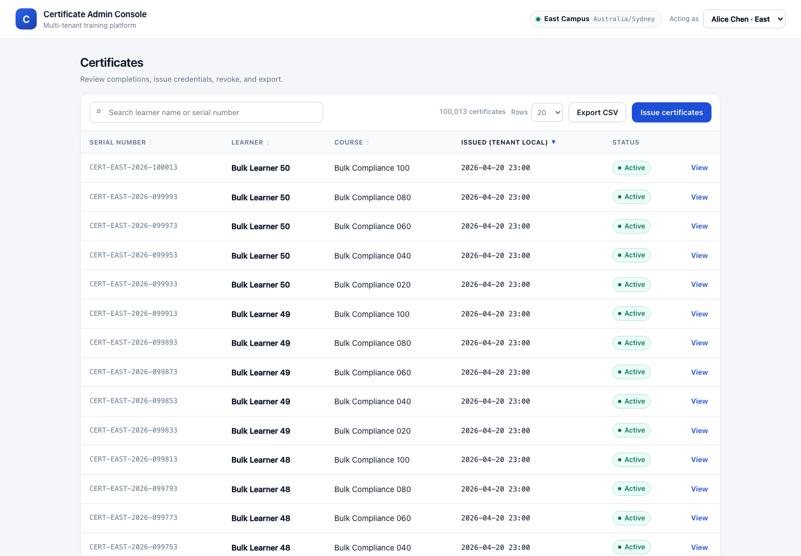

# Certificate Admin Console

Multi-tenant internal admin console for a training platform: review course completions,
issue certificates in bulk, revoke them with an audit trail, and export certificate data.
Built for the Ocean AI Labs Beijing technical interview assessment (`docs/briefing.pdf`).



- Backend: **Python 3.11+ / FastAPI / SQLite (WAL)**
- Frontend: **React 19 + TypeScript + Vite**, built to `web/dist` and served by FastAPI
- One process, one origin, one command to start
- 7 acceptance scenarios covered by `pytest` (`./verify.sh`)

Design rationale, data model, and tradeoffs: [`DESIGN.md`](DESIGN.md).

---

## 1. Quick start (one command)

Requirements: **Python 3.11+** and **Node 20.19+ / npm 10+** (or pnpm, not required).

```bash
./start.sh
# → http://127.0.0.1:8000
```

`start.sh` creates `.venv`, installs `requirements.txt`, installs the web dependencies if
missing, builds the SPA, seeds the demo database when it is empty, then runs Uvicorn.
Nothing else needs to be started.

| Variable / flag | Default | Meaning |
|---|---|---|
| `PORT` | `8000` | HTTP port |
| `DB_PATH` | `data/app.db` | SQLite file (created and seeded if empty) |
| `PYTHON` | `python3` | Interpreter used to create the venv |
| `./start.sh --reset` | — | wipe and reseed the demo data |

The database is a file, not a service: `data/app.db` is created on first start and is
git-ignored.

## 2. Verification (second command)

```bash
./verify.sh
# => 17 passed  (A1–A7, reason-hash, logging)  + TypeScript type check
```

`verify.sh` installs `requirements-dev.txt`, runs `pytest tests/`, then runs `tsc --noEmit`
for the web app. The A6 test generates 100,000 certificates inside the test database and
asserts the export budget, so the suite takes a few seconds.

## 3. Actors and tenancy

There is no login (by design). The acting admin is identified by a request header:

```
X-Actor-Email: alice@east.test
```

| Admin | Email | Tenant | Timezone |
|---|---|---|---|
| Alice Chen | `alice@east.test` | East Campus | `Australia/Sydney` |
| Bob Miller | `bob@west.test` | West Campus | `Australia/Perth` |

The console has an **Acting as** switcher in the header. Changing the actor changes the
tenant and therefore every list, detail, bulk-issue, revoke, and export response. The
tenant is always derived server-side from the admin row — no endpoint accepts a tenant id.

## 4. Demo data

Both tenants contain the course **Safety 101** and the learner **Alex Lee** (the A5
fixtures). Extra courses exist so each scenario can be demonstrated without setup.

| Tenant | Course | Learner | Enrollment | Seeded certificate |
|---|---|---|---|---|
| East | Safety 101 | Alex Lee | completed | ACTIVE, `2026-01-10T13:30:00Z` |
| East | Safety 101 | Maya Chen | completed | — |
| East | Safety 101 | Priya Nair | completed | — |
| East | Safety 101 | Tom Baker | incomplete | — |
| East | Fire Safety | Ava Rodriguez, Ethan Brooks, Liam Wong, Noah Patel | completed | — |
| East | Data Privacy | Sophia Turner | completed | ACTIVE |
| East | Data Privacy | Isla Murphy | completed | REVOKED |
| East | Data Privacy | James Cole | incomplete | — |
| East | Hazard Reporting | 10 learners | completed | ACTIVE (for pagination) |
| West | Safety 101 | Alex Lee | completed | ACTIVE, `2026-01-10T13:30:00Z` |
| West | Safety 101 | Sam Rivera | completed | — |
| West | Safety 101 | Dana Kim | incomplete | — |
| West | Fire Safety | Grace Liu, Omar Haddad, Nina Petrova | completed | — |

Totals: East has 13 certificates (page size 10 or 20 shows pagination), West has 1.
Seed rows are deterministic; `python -m app.seed --reset` rebuilds them.

## 5. Acceptance scenarios A1–A7

Start the app (`./start.sh`) and use `http://127.0.0.1:8000`. Every scenario is also
automated in `tests/test_a*.py`; the commands below are the manual reproduction.

### A1 — tenant isolation

```bash
# Bob only ever sees West data
curl -s -H 'X-Actor-Email: bob@west.test' localhost:8000/api/certificates | jq '.total, .items[].serial'
# 1, CERT-WEST-2026-000001

# Cross-tenant detail → 404, identical to a missing certificate
curl -s -o /dev/null -w '%{http_code}\n' -H 'X-Actor-Email: bob@west.test' \
  localhost:8000/api/certificates/cert_east_alex_safety          # 404

# Cross-tenant bulk issue → 404, no certificates and no audit events written
curl -s -o /dev/null -w '%{http_code}\n' -X POST localhost:8000/api/certificates/bulk-issue \
  -H 'X-Actor-Email: bob@west.test' -H 'Idempotency-Key: cross-1' \
  -H 'Content-Type: application/json' -d '{"courseId":"course_east_fire"}'   # 404

# Cross-tenant revoke → 404
curl -s -o /dev/null -w '%{http_code}\n' -X POST -H 'X-Actor-Email: bob@west.test' \
  localhost:8000/api/certificates/cert_east_alex_safety/revoke                # 404
```

In the UI: switch to Bob Miller — the list, the export, and the course picker contain only
West rows; opening an East certificate from a copied URL shows "Certificate not found".

### A2 — retry safety (same Idempotency-Key)

```bash
for i in 1 2 3; do
  curl -s -X POST localhost:8000/api/certificates/bulk-issue \
    -H 'X-Actor-Email: alice@east.test' -H 'Idempotency-Key: demo-a2' \
    -H 'Content-Type: application/json' -d '{"courseId":"course_east_fire"}' \
  | python3 -c 'import json,sys; d=json.load(sys.stdin); print(d["operationId"], d["summary"])'
done
```

All three responses have the **same `operationId`** and the same body; the first has
`Idempotency-Replayed: false`, the retries `true`. Fire Safety has four eligible learners,
so exactly four certificates and four `ISSUED` audit events exist afterwards — check with
`curl .../api/certificates?q=Fire` or `sqlite3 data/app.db 'select count(*) from audit_events'`.

Concurrent variant:

```bash
seq 1 6 | xargs -P6 -I{} curl -s -o /dev/null -w '%{http_code}\n' -X POST \
  localhost:8000/api/certificates/bulk-issue \
  -H 'X-Actor-Email: alice@east.test' -H 'Idempotency-Key: demo-a2-parallel' \
  -H 'Content-Type: application/json' -d '{"courseId":"course_east_safety"}'
```

Results: six 200s, one operation, two new certificates (Maya Chen, Priya Nair), two audit
events, and Alex Lee/Tom Baker skipped.

### A3 — key misuse

```bash
curl -s -X POST localhost:8000/api/certificates/bulk-issue \
  -H 'X-Actor-Email: alice@east.test' -H 'Idempotency-Key: demo-a2' \
  -H 'Content-Type: application/json' -d '{"courseId":"course_east_safety"}' \
  -w '\n%{http_code}\n'          # {"code":"idempotency_key_reuse",...}  409
```

No second operation runs and the stored result for `demo-a2` is untouched (retry the A2
command and you still get the Fire Safety outcome).

`reason` is part of that payload: the same course with a different reason is the same
`409 idempotency_key_reuse`, so a second reason is refused instead of being silently
dropped from the audit trail. A blank reason (`null`, `""`, whitespace) counts as no
reason.

### A4 — learner outcomes

```bash
curl -s -X POST localhost:8000/api/certificates/bulk-issue \
  -H 'X-Actor-Email: alice@east.test' -H 'Idempotency-Key: demo-a4' \
  -H 'Content-Type: application/json' -d '{"courseId":"course_east_safety"}' | jq '.summary, .outcomes'
```

`issued` for the two completed, uncertified learners; `skipped` +
`already_certified` for Alex Lee; `skipped` + `incomplete_enrollment` for Tom Baker.
The UI shows the same table with per-learner reasons.

### A5 — DST and tenant-local dates

```bash
curl -s -H 'X-Actor-Email: alice@east.test' 'localhost:8000/api/certificates?q=Alex' \
  | jq '.items[0] | {issuedAt, issuedAtLocal, issueDateLocal}'
# 2026-01-10T13:30:00Z | 2026-01-11 00:30 | 2026-01-11     (Sydney, AEDT)

curl -s -H 'X-Actor-Email: bob@west.test' 'localhost:8000/api/certificates?q=Alex' \
  | jq '.items[0] | {issuedAt, issuedAtLocal, issueDateLocal}'
# 2026-01-10T13:30:00Z | 2026-01-10 21:30 | 2026-01-10     (Perth, AWST)

curl -s -H 'X-Actor-Email: alice@east.test' \
  'localhost:8000/api/certificates/export.csv?q=Alex&sort=serial&dir=asc'
# learner_name,course_title,serial_number,issue_date
# Alex Lee,Safety 101,CERT-EAST-2026-000001,2026-01-11
```

List sorting and CSV both use the tenant-local calendar date; `issuedAt` remains UTC.

### A6 — 100,000-row export

```bash
.venv/bin/python scripts/generate_large.py --tenant east --count 100000
DB_PATH=data/large.db ./start.sh           # second terminal, default DB untouched

time curl -s -H 'X-Actor-Email: alice@east.test' -o /tmp/large.csv \
  'http://127.0.0.1:8000/api/certificates/export.csv?sort=learner_name&dir=asc'
wc -l /tmp/large.csv                       # 100014 (header + 100,013 East rows)
```

Measured on this machine: **~0.24 s**, 7.0 MB CSV. While the export stream is open, a list
request still returns in **~4 ms** (see `tests/test_a6_export.py`, which asserts both the
60 s budget and the concurrent list). Repeated exports are byte-identical, including rows
with equal learner names / timestamps — the order is `sort key, certificate id` (both in
the sort direction).

**Capacity beyond the brief (same machine, SQLite file):**

| Rows | Export | CSV size | List during export | Deep page | Search |
|---|---|---|---|---|---|
| 100,000 | 0.24 s | 7.0 MB | 3.9 ms | 6 ms | 17 ms |
| 300,000 | 1.27 s | 21 MB | 10 ms | 15 ms | 43 ms |
| 1,000,000 | 3.62 s | 70 MB | 24 ms | 48 ms | 142 ms |

Streaming memory stays flat: `tracemalloc` peak was ~5 MB for 100k rows and ~3.5 MB for 1M.
Bulk issue, the only synchronous write path, scales linearly and blocks other *writers*
(reads stay available):

| Learners | Duration | Response | Revoke waiting during the issue |
|---|---|---|---|
| 1,000 | 0.08 s | 165 KB | — |
| 10,000 | 0.67 s | 1.7 MB | — |
| 20,000 | 1.4 s | 3.3 MB | — |
| 50,000 | 4.0 s | 8.6 MB | 3.7 s |

The first version of this export was 61.7 s at 1M rows (super-linear); the two-step keyset
and index hint in `export_batch` fixed it. `tests/test_a6_export.py` caught the intermediate
bug where rows were silently skipped, because it asserts the exact row count.



### A7 — revocation audit

```bash
curl -s -X POST localhost:8000/api/certificates/cert_east_sophia_privacy/revoke \
  -H 'X-Actor-Email: alice@east.test' -H 'Content-Type: application/json' \
  -d '{"reason":"issued in error"}' | jq '{status: .certificate.status, alreadyRevoked, audit: (.audit|length)}'
# {"status":"REVOKED","alreadyRevoked":false,"audit":2}

curl -s -X POST localhost:8000/api/certificates/cert_east_sophia_privacy/revoke \
  -H 'X-Actor-Email: alice@east.test' -H 'Content-Type: application/json' -d '{}' \
  | jq '{status: .certificate.status, alreadyRevoked, audit: (.audit|length)}'
# {"status":"REVOKED","alreadyRevoked":true,"audit":2}
```

Exactly one `REVOKED` audit event, enforced by a unique index on
`(certificate_id, action)`. In the UI the detail drawer requires an explicit confirmation
step before revoking, and shows the resulting audit timeline.

## 6. API summary

All endpoints are under `/api` and require `X-Actor-Email`.

| Method | Path | Description |
|---|---|---|
| `GET` | `/me` | current actor and tenant |
| `GET` | `/courses` | tenant courses with eligible / certified / incomplete counts |
| `GET` | `/certificates` | `q`, `page`, `pageSize` (≤100), `sort` (`issued_date`, `learner_name`, `course_title`, `serial`), `dir` (`asc`/`desc`) |
| `GET` | `/certificates/{id}` | certificate + audit timeline (404 across tenants) |
| `POST` | `/certificates/bulk-issue` | `Idempotency-Key` header + `{"courseId": "..."}` |
| `POST` | `/certificates/{id}/revoke` | idempotent revocation, optional `{"reason": "..."}` |
| `GET` | `/certificates/export.csv` | same `q`/`sort`/`dir`, streamed CSV |
| `GET` | `/health` | liveness + database check |

Errors use `{"code", "message", "details"}`; `401` unknown actor, `404` missing or
cross-tenant resource, `409` idempotency conflict, `422` validation, `400` missing
idempotency key.

## 7. How the hard parts work

- **Tenant isolation** — the tenant comes from the admin row, every SQL statement carries
  `tenant_id`, and cross-tenant ids return the same 404 as missing ones. Composite foreign
  keys prevent a certificate from referencing another tenant's course.
- **Idempotency** — a `(tenant_id, key)` row stores the request hash and the serialised
  response inside the same `BEGIN IMMEDIATE` transaction as the issuance. Retries replay
  the stored bytes; a different payload is a 409. The database also enforces one
  certificate per `(tenant, course, learner)`, so duplicates are impossible even under a
  race.
- **Timezone** — timestamps are UTC; `issue_date_local` is persisted at issuance for
  sorting and CSV, while display strings are derived from the tenant's IANA zone.
- **Streaming export** — async generator over 2,000-row pages fetched in the worker-thread
  pool, with a `max(seq)` snapshot horizon. Each page is two index seeks (drain the current
  sort key, then jump to the next) behind an explicit `INDEXED BY` hint; the event loop is
  never blocked.
- **Audit integrity** — issuance and revocation events are inserted in the same
  transaction as the state change, and `unique(certificate_id, action)` makes duplicates
  physically impossible.

## 8. Logging

Both tiers log with four levels — `debug`, `info`, `warn`, `error` — and share a request id
so a browser action can be followed into the server log.

### 8.1 Backend

Configured in [`app/logging.py`](app/logging.py); one line per event.

| Variable | Default | Meaning |
|---|---|---|
| `LOG_LEVEL` | `INFO` | `DEBUG` / `INFO` / `WARNING` / `ERROR` |
| `LOG_FORMAT` | `text` | `text` (human) or `json` (one object per line) |
| `LOG_SLOW_REQUEST_MS` | `2000` | requests slower than this log at `WARNING` as `request.slow` |

Every request produces one line from the ASGI middleware in
[`app/middleware.py`](app/middleware.py) with `method`, `path`, `status`, `durationMs`,
`actor`, `tenant`, and `request_id`; the response carries `X-Request-Id`. Business events are
emitted next to the code that owns them:

| Event | Level | Fields |
|---|---|---|
| `bulk_issue.start` / `.done` | INFO | operationId, courseId, issued/skipped/failed, durationMs (start is emitted only when the request actually executes) |
| `bulk_issue.replay` | INFO | operationId of the stored operation (no new attempt is logged) |
| `bulk_issue.conflict` | WARNING | keyHash, courseId |
| `bulk_issue.course_not_found` | WARNING | courseId (cross-tenant or missing) |
| `certificate.revoked` / `.revoke_replay` | INFO | certificateId, serial |
| `certificate.revoke_not_found` | WARNING | certificateId |
| `export.start` / `.done` | INFO | sort, dir, rows, durationMs |
| `auth.rejected` | WARNING | reason, attempted email |
| `request.failed` | ERROR | status 500 + traceback |

```text
2026-10-27T05:19:10.207Z INFO    app.certificates     bulk_issue.done request_id=b5e7337033cf operationId=op_e99c78eb5ab545a0 courseId=course_east_fire issued=4 skipped=0 failed=0 durationMs=1.1 actor=alice@east.test tenant=east
```

```bash
LOG_FORMAT=json ./start.sh    # {"ts":"...","level":"INFO","logger":"app.request","event":"request","request_id":"...","method":"GET","path":"/api/certificates","status":200,"durationMs":19.9,"actor":"alice@east.test","tenant":"east"}
```

`DEBUG` adds list/export internals (`certificates.list` with page/sort/total). `WARNING`
covers idempotency conflicts, cross-tenant write attempts, rejected actors, and slow
requests. Request bodies, headers, learner names, and learner emails are never logged.

`start.sh` runs Uvicorn with `--no-access-log`: the middleware replaces the default access
log and adds the fields above.

### 8.2 Frontend

[`web/src/log.ts`](web/src/log.ts) mirrors the same levels.

- Default level: `debug` in the Vite dev server, `info` in the production build; override
  with `VITE_LOG_LEVEL` at build time.
- At runtime: `setLogLevel("debug")` in the browser console (persisted in
  `localStorage["cca.logLevel"]`), `getLogLevel()` to read it.
- Logged: `app.boot`, `actor.switch`, `api.request` / `api.response` / `api.error` /
  `api.network_error`, `bulk_issue.submit` / `.result` / `.failed`, `export.start` / `.done`,
  `certificate.revoke.submit`, plus `window.error` and `unhandledrejection`.
- Each API call sends a generated `X-Request-Id` (`web-…`) and logs it, so the browser line
  and the server line share one id:

```text
[debug] api.response {requestId: "web-ef5464810e9a", status: 200, durationMs: 2}
→ 2026-10-27T05:20:38.328Z INFO app.request request request_id=web-ef5464810e9a method=GET path=/api/certificates/cert_east_isla_privacy status=200 durationMs=2.5 actor=alice@east.test tenant=east
```

Client logs stay in the browser console — there is no log-shipping endpoint (see known
defects).

## 9. Repository layout

```
app/                 FastAPI application
  schema.sql         DDL and indices
  db.py              WAL connections + BEGIN IMMEDIATE helper
  auth.py            X-Actor-Email resolution (server-side tenant)
  services/          listing, detail, bulk issue, revocation, export queries
  routers/api.py     HTTP endpoints
  seed.py            deterministic demo data
  bulkdata.py        100k-row fixture generator
web/                 React + TypeScript console (Vite)
tests/               A1–A7 pytest suites + live-server A6 test
scripts/generate_large.py
docs/                briefing, design screenshots
ai/                  AI interaction evidence (sessions, index, decision log)
AGENTS.md            AI instructions used for this repository
DESIGN.md            data model, API contract, tradeoffs
written-answers.md   Section 6 written answers (candidate, no AI)
```

## 10. Known defects and unfinished work

1. **No authentication.** The actor header is a demo affordance; anyone can spoof it.
   Out of scope per the brief, but it is the first thing to fix for production.
2. **SQLite single-writer.** Concurrent bulk issues serialise on the write lock, and a
   revocation issued during a 50k-learner bulk issue waited 3.7 s for the commit (reads are
   unaffected). At that cohort size the request should become a queued job.
3. **Export is not a full MVCC snapshot.** The `max(seq)` horizon hides certificates
   issued mid-export, but a revocation committed between two batches can still show up in
   a later batch. Acceptable for an admin download; a materialised snapshot would fix it.
4. **Search folding is ASCII-only.** SQLite `LIKE` does not case-fold non-ASCII names.
5. **No automated UI tests.** The backend is covered by pytest; the UI was verified
   manually (Chrome screenshots in `docs/screenshots/`) and against the same scenarios.
   Playwright coverage would be the next investment.
6. **OFFSET pagination.** Deep pages measured 6 ms (100k) / 15 ms (300k) / 48 ms (1M) and a
   page far past the end 13 ms / 38 ms / 128 ms, so it is acceptable here; keyset pagination
   is still the correct next step for very large offsets.
7. **Revoked certificates cannot be reissued** — the unique
   `(tenant, course, learner)` constraint keeps one credential per learner/course. This is
   a documented product rule, not an oversight; a reissue flow would need a new serial
   policy.
8. **Client logs are console-only.** There is no `/api/client-logs` sink, no sampling, and
   no retention; a browser tab closing loses its logs.
9. **Logs go to stdout only.** No file sink, rotation, or retention policy; a collector is
   expected to own that in any real deployment.
10. The 100k database (`data/large.db`, 65 MB) is git-ignored; regenerate it with the
    command in §5-A6.

## 11. AI assistance and evidence

The build was AI-assisted. All interactive sessions, decisions, and limitations are in
[`ai/`](ai/):

- `ai/sessions/` — native session exports (JSONL) including prompts, tool calls, commands,
  errors, and timestamps
- `ai/session-index.csv` — one row per session with model, window, export file, commits
- `ai/decision-log.md` — accepted, rejected/corrected, and tradeoff decisions with
  verification evidence and commit links
- `ai/completeness-declaration.md` — tools used, export limitations, and the Section 6
  confirmation

Section 6 (`written-answers.md`) is the only no-AI part of the assessment and was written
by the candidate alone.
